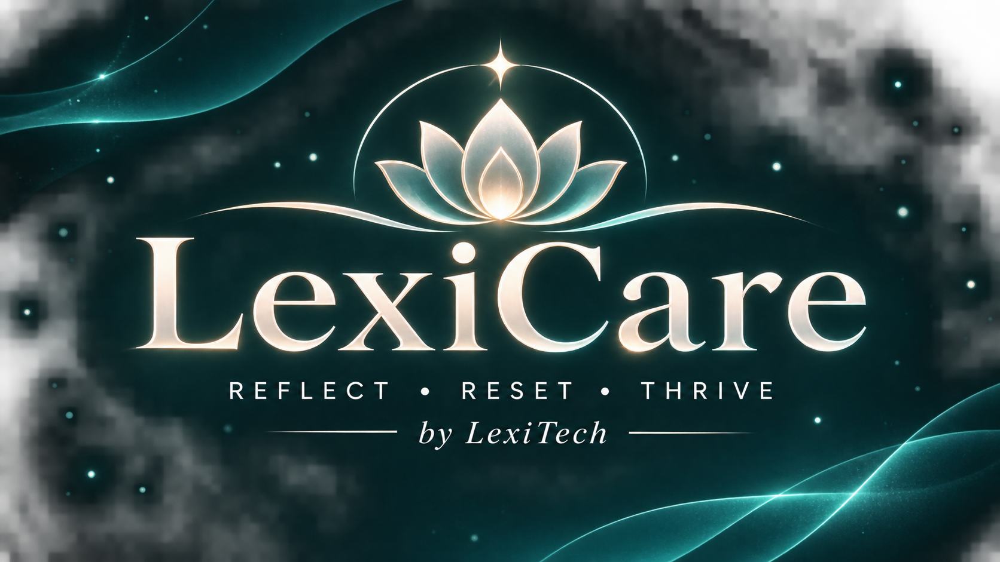

  

 🌿 LexiCare (Powered by LexiTech)

**Your 24/7 Safe Space, Ambient Retreat & AI Companion**

LexiCare is a judgment-free digital wellness space built by **LexiTech Studio**. Whether you need to vent after a long day, talk through late-night overthinking, unwind with nature soundscapes, or play a low-stress distraction game, Lexi is always here to listen.

---

### ✨ Key Features

* **Unlimited Conversational Chat & Voice:** Powered by Google Gemini and natural neural voice replies (`en-US-AvaMultilingualNeural`) with zero message caps or credit walls.
* **Three Companion Modes:** Switch anytime between **Just Listen (Vent)**, **Help Me Problem-Solve**, and **Distract Me / Play a Game**.
* **Built-In Nature Soundscapes:** Loop **Soft Rain**, **Ocean Waves**, or a **Forest Waterfall** directly in the background while you chat.
* **60-Second Calm Reset & Brain Dump Shredder:** Guided breathing timer and a quick thought-clearing tool built right into the sidebar.
* **Crisis Safety Shield:** Automatic high-risk detection and an always-visible **Human Support** button offering one-tap connections to **988**, **741741**, **911**, and a user-set **Trusted Person**.

---

### ⚠️ Important Disclaimer

*LexiCare is an AI wellness companion designed for reflection, relaxation, and general support. Lexi is not a licensed therapist, counselor, or medical professional, and cannot diagnose conditions or automatically dispatch emergency services.*

---

### 🚀 Built With

* [Streamlit](https://streamlit.io)
* [Google Gemini API](https://google.dev)
* [Edge-TTS](https://github.com) & NumPy Procedural Audio

---

*Created by **Heidi Seckman** • **LexiTech Studio***
